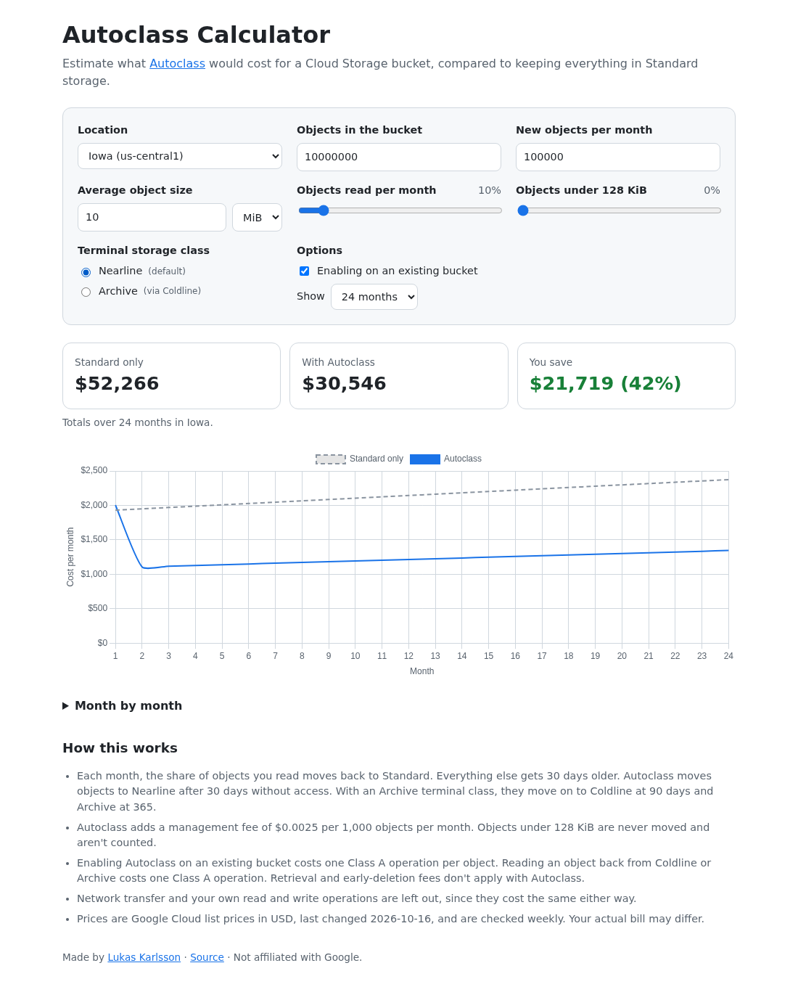

# Autoclass Calculator

[](https://github.com/lukwam/autoclass/actions/workflows/ci.yml)
[](docs/prices.json)
[](https://lukwam.github.io/autoclass/)
[](LICENSE)

Estimate what [Autoclass](https://cloud.google.com/storage/docs/autoclass) would cost for a Google Cloud Storage bucket, compared to keeping everything in Standard storage.

**[Open the calculator →](https://lukwam.github.io/autoclass/)**

[](https://lukwam.github.io/autoclass/)

## What it models

Describe your bucket (size, growth, how often objects are read, and how many are under 128 KiB), and the calculator projects monthly costs with and without Autoclass:

- **Storage class transitions.** Unread objects move to Nearline after 30 days. With an Archive terminal class, they continue to Coldline at 90 days and Archive at 365.
- **Terminal storage class.** Nearline is the default. Archive saves more for cold data.
- **Management fee** of $0.0025 per 1,000 objects per month. Objects under 128 KiB aren't managed or charged.
- **Enablement charge** of one Class A operation per object when turning Autoclass on for an existing bucket.
- **Class A operations** when a read moves an object back from Coldline or Archive.
- **50 locations**, each with its own list prices.

Network transfer and your own reads and writes cost the same either way, so they're left out. Scenarios are saved in the URL, so you can share a link to a specific one.

> [!NOTE]
> Since this calculator was first published, Autoclass gained the terminal storage class setting, and **Nearline became the default**. Objects only reach Coldline and Archive if you choose Archive. For the same bucket, the default can save noticeably less than the Archive setting, so the calculator shows both.

## Keeping prices current

Prices come from the [Cloud Billing Catalog API](https://cloud.google.com/billing/docs/reference/rest/v1/services.skus/list) and live in [`docs/prices.json`](docs/prices.json). Every Monday, the [Update prices](.github/workflows/prices.yml) workflow fetches them again. If anything changed, it tests the new prices and opens a pull request. Merging the PR publishes the new prices. The `updated` date only changes when a price does.

The workflow needs a repository secret named `BILLING_API_KEY`: a Google Cloud API key restricted to the Cloud Billing API. The catalog is public pricing data, and reading it is free.

```bash
gcloud services enable cloudbilling.googleapis.com --project=MY_PROJECT
gcloud services api-keys create --project=MY_PROJECT --display-name="autoclass prices" \
  --api-target=service=cloudbilling.googleapis.com
gh secret set BILLING_API_KEY --repo lukwam/autoclass   # paste the keyString
```

To refresh prices by hand, run `python scripts/update_prices.py`. It uses your `gcloud` login.

## Development

It's a static site in [`docs/`](docs/), served by GitHub Pages, with no build step. The cost model is in [`docs/model.js`](docs/model.js).

```bash
python3 -m http.server -d docs 8000   # http://localhost:8000
node --test                           # model and prices.json tests
pre-commit install                    # ruff, ty, Biome, markdownlint
```

## License

[MIT](LICENSE)
